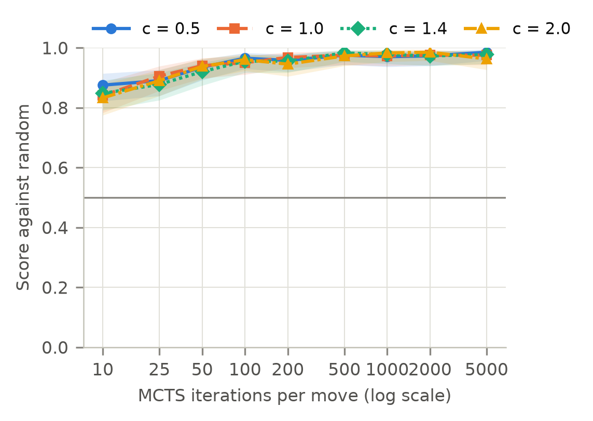

## Abstract

We compare exact adversarial search and finite-budget Monte Carlo Tree Search in square placement games and simplified Xiangqi. A shared Python implementation supports Minimax, Alpha-Beta, standard UCT, five selection alternatives, and random or heuristic simulation. The frozen evidence contains 43,000 3x3 games, 4,590 five-in-a-row games, and 150 Xiangqi games. Exact enumeration supplies 4,520 nonterminal 3x3 states for action-quality checks. Results distinguish complete 3x3 experiments from incomplete larger-game grids. Finite-budget MCTS exhibits errors and does not inherit the non-loss guarantee of exact search. The implementation includes resumable match logs, explicit missing-data flags, and a browser demo. This review draft reports measured results and methodological limitations rather than claiming completion of the entire planned grid.

Index Terms - game search, Minimax, Alpha-Beta, MCTS, UCT, reproducibility.

## I. Introduction

Board games expose a useful tension in artificial intelligence: a decision can be exact but expensive, or approximate and available within a fixed computation budget. Tic-Tac-Toe on a 3x3 board is small enough to solve completely. Five-in-a-row and Xiangqi introduce much larger branching factors and make selective search practically necessary. Studying the three settings in one codebase separates correctness on a tractable game from playing strength under resource limits.

The coursework asks for Minimax with Alpha-Beta pruning, an extension to MCTS with UCT, controlled parameter experiments, and a playable demonstration. It also asks to investigate a never-lose statement for Tic-Tac-Toe. We treat that statement as a falsifiable question. A stochastic algorithm stopped after a finite number of iterations cannot acquire an unconditional guarantee merely by winning a sample of games.

Our questions are: RQ1, does pruning preserve exact decisions while reducing visited nodes? RQ2, how do exploration constant and iteration budget affect score and exact-action errors? RQ3, what changes when rollout policy, final-move rule, or exploration formula changes? RQ4, which conclusions survive extension to larger boards and simplified Xiangqi? Each question is tied to executable experiments and raw records.

## II. Problem Formulation

A placement-game state consists of a square board, side to move, and target run length k. An action places the current player's stone in an empty cell. A horizontal, vertical, or diagonal run of at least k wins; a full board without a winner is a draw. The experiments use (size,k)=(3,3) and (9,5). These are freestyle rules: overlines count, and no blocked-end or Renju restrictions apply. The demo additionally offers 15x15, but this is not the experimental board size.

Represent players by +1 and -1. Let z be +1 for a first-player win, -1 for a second-player win, and 0 for a draw. Minimax evaluations are oriented toward +1. MCTS uses bounded reward r=(z+1)/2 for player +1 and 1-r for player -1. A draw therefore contributes half a point. Throughout this report W means accumulated reward, not solely the number of wins.

Xiangqi uses a 10x9 board and the seven usual piece types. Legal tree actions enforce the palace, river restrictions, horse-leg and elephant-eye blocking, cannon screens, flying generals, and self-check avoidance. With no legal reply, the player to move loses, including stalemate. Practical draw rules use threefold repetition, 120 plies without capture, or a 200-ply game cap. These simplified rules do not implement tournament adjudication of perpetual checking or chasing.

### A. Exact Baseline and Evaluation

For terminal states the search value is z times (1,000,000 minus search ply), with zero for a draw. This tie-break favors faster wins and delays unavoidable losses. At depth zero an unfinished placement board is scored by unblocked k-cell windows; Xiangqi uses material plus small positional terms. A depth-limited value is a heuristic assessment, not a proof of the game's outcome.

Full-tree Minimax on 3x3 supplies an optimal-action oracle. A move-quality error occurs when an action reduces the exact game-theoretic value of its state. A separate independent tablebase test compares both exact search implementations across all reachable boards, including all tied optimal choices. This checks more than agreement between two algorithms that could share the same defect.

## III. Methods

### A. Minimax and Alpha-Beta

Minimax maximizes values at +1 nodes and minimizes them at -1 nodes. Alpha-Beta tracks the best alternative already available to each player and stops exploring a branch once that branch cannot alter the ancestor's decision. On the same tree, at the same depth, this changes work rather than the optimum. Move ordering explores higher-prior moves earlier and can increase pruning. Node counts include the root and terminal or cutoff nodes.

The root searches with a one-point margin around its current best integer value so that an action tied for best is distinguished from an action cut off at the incumbent bound. The returned move set is therefore tested, not just the returned value. Search on an already finished state returns no move. A requested depth of zero evaluates the root without expanding it.

On larger placement boards an optional candidate radius restricts considered cells to a neighborhood of existing stones. This is an explicit action-set approximation. An Alpha-Beta result remains comparable with Minimax only if both use the same restriction. A shallow, radius-restricted agent must not be advertised as a solved-game player.

### B. MCTS Implementation

Each decision builds a new tree on cloned game positions. Selection descends through fully expanded nodes using a child score. Expansion adds one untried action. Simulation produces a bounded result. Backpropagation increments visit counts and adds reward to every node on the path. A child's reward belongs to the player who moved into that child, so each decision node maximizes the reward of its own acting player.

The standard selection index is S_i=W_i/N_i+c sqrt(ln(N_p)/N_i). All unvisited actions are expanded before using the index. When the iteration budget is exhausted, the robust rule selects maximum N, with accumulated reward breaking ties. The alternative selects maximum W/N and breaks ties by visits. A high mean based on very few samples can be optimistic; a large visit count usually has more support. Neither criterion is an unconditional certificate of move quality.

### C. Simulation Policies

Uniform rollout samples remaining placement cells randomly. The heuristic checks recent winning or blocking opportunities and prefers nearby cells. It examines recent threats, not every possible tactical threat. Cutoff simulation stops early and transforms a hand-written evaluation through a sigmoid. This is a value estimate, without a trained network.

### D. Why the Square Root and Logarithm?

For independent observations in [0,1], a one-sided Hoeffding bound gives P(mu-mean >= e) <= exp(-2 n e squared). Setting the tail probability to t to the power -4 gives e=sqrt(2 ln(t)/n). This motivates an optimistic sample mean plus uncertainty radius and the UCB1 coefficient sqrt(2). The square root sets the uncertainty scale, while logarithmic dependence keeps neglected alternatives eligible for further sampling as time passes [1].

UCT applies the bandit allocation idea inside a planning tree [2]. Its descendants evolve during search, so the elementary independent-arm sketch is not a complete theorem about the game implementation. In particular, it does not establish a finite iteration threshold above which every random realization plays perfectly. The c grid is an empirical investigation of exploration scale, not a claim that one coefficient is universally optimal.

We implement no-square-root and no-log ablations, a polynomial exploration term, empirical-variance UCB1-Tuned, and a decaying progressive move prior. They are candidate policies. Equal names across the game and explanatory bandit experiments are checked for formula consistency. A modification is an improvement only when replicated outcomes support it under the stated opponent and budget.

## IV. Experimental Design

Each match record contains game, experiment, both complete agent configurations, game index, side assignment, outcome, plies, search time, nodes, deterministic seed, and full move sequence. Seeds derive from a SHA-256 digest of configuration and index. Even and odd indices alternate who moves first. The append-only match runner resumes completed configurations without intentionally replaying them. Corrupt or incomplete records are excluded and reported.

The predefined match grid has 200 games per configuration for 3x3, 100 for 9x9, and 50 for Xiangqi. Exploration values are 0.5, 1.0, 1.4, and 2.0. Larger-game curves use 100, 200, 500, 1,000, 2,000, and 5,000 iterations per move. The 3x3 suite also includes smaller budgets to expose failure modes. Opponents include random, exact 3x3 play, depth-limited Alpha-Beta, and fixed-budget MCTS.

We separate count-based work from wall time. Equal iterations need not cost equal time when simulations differ. Timings from a busy workstation are descriptive measurements; uncontrolled background load prevents precise speed claims.

## V. Results

### A. Coverage and Exact Search

The following coverage counts belong to the frozen raw files listed by hash in paper/metrics.json. Planned counts refer to the original grid; supplementary pairings are excluded from planned completion even when they meet the 50-game minimum.

| Suite | Planned games present / total | All observed games |
|---|---|---|
| 3x3 | 43,000 / 43,000 | 43,000 |
| Five-in-a-row 9x9 | 4,590 / 6,700 | 4,590 |
| Xiangqi | 50 / 3,200 | 150 |

| 3x3 start algorithm | Nodes | Value |
|---|---|---|
| minimax | 549,946 | 0 |
| alphabeta | 31,621 | 0 |
| alphabeta_ordered | 22,294 | 0 |

The empty 3x3 board is draw-valued. The table shows the recorded full-search node counts for the three search modes. This comparison is meaningful because the starting position and legal tree are shared. More difficult node experiments may have missing or explicitly skipped measurements; those are not zero-cost searches and are not averaged into completed measurements.

### B. Exact-Action Quality of MCTS

| Iterations | Positions | Blunders | Rate |
|---|---|---|---|
| 10 | 13,560 | 1,462 | 0.1078 |
| 25 | 13,560 | 787 | 0.0580 |
| 50 | 13,560 | 382 | 0.0282 |
| 100 | 13,560 | 246 | 0.0181 |
| 200 | 13,560 | 137 | 0.0101 |
| 500 | 13,560 | 61 | 0.0045 |
| 1000 | 13,560 | 23 | 0.0017 |
| 2000 | 13,560 | 0 | 0.0000 |
| 5000 | 13,560 | 0 | 0.0000 |

For each budget the quality check covers 4,520 nonterminal positions per seed, with three seeds. A blunder is determined by the exact action-value oracle, not by whether a later random opponent happens to exploit it. This is a stricter diagnostic than win rate against a weak opponent. The rates above pool repeated visits to the same finite board set; they should not be interpreted as independent game trials.

### C. Opponent-Tree Enumeration

| Iterations | Seed/side runs | Leaf paths | Loss paths |
|---|---|---|---|
| 50 | 40 | 12,858 | 858 |
| 100 | 40 | 12,448 | 465 |
| 200 | 40 | 12,159 | 245 |
| 500 | 40 | 11,749 | 74 |
| 1000 | 40 | 11,501 | 15 |
| 2000 | 40 | 11,372 | 0 |
| 5000 | 40 | 11,352 | 0 |

For each iteration budget the verifier runs twenty seeds in each role, branching over every legal opponent reply while the MCTS player follows its seeded choices. These counts summarize terminal paths, not independent matches. A zero in the loss-path column is conditional evidence for those seeded policies and traversals. Positive loss counts are direct counterexamples to an unrestricted never-lose claim. No confidence bound treating all leaf paths as independent is justified.

### D. Iteration and Exploration Curves

The curve is tied to a specified opponent. Score against random play and probability of avoiding loss against perfect play answer different questions. A strong curve against random play cannot replace the state-based diagnostic or opponent enumeration. Likewise, choosing a visually best c from this same grid is exploratory analysis rather than evaluation on an independent held-out workload.

The larger-board curves remain partial. Missing parameter cells must remain gaps or be labeled no data; interpolation would imply a result that has not been measured. A report generator that survives missing inputs is useful only when it preserves that distinction in its tables and conclusions.

### E. Recorded Match Outcomes

| Game / opponent | Iter. | n | W / D / L |
|---|---|---|---|
| gomoku9 / alphabeta d=1 | 1000 | 100 | 0 / 0 / 100 |
| gomoku9 / alphabeta d=2 | 1000 | 100 | 0 / 0 / 100 |
| gomoku9 / random | 1000 | 100 | 100 / 0 / 0 |
| ttt3 / alphabeta d=None | 1000 | 200 | 0 / 196 / 4 |
| ttt3 / perfect | 1000 | 200 | 0 / 193 / 7 |
| ttt3 / random | 1000 | 200 | 191 / 9 / 0 |
| xiangqi / alphabeta d=1 | 100 | 50 | 7 / 0 / 43 |
| xiangqi / random | 100 | 50 | 33 / 14 / 3 |

W, D, and L are from the MCTS agent's perspective, regardless of its side. n is the actual number of completed games in that pairing, not the desired total. The full generated tables include remaining budgets and configurations. The newly measured Xiangqi 100-iteration pairings are supplementary baselines, not completion of the planned 1,000/5,000-iteration WDL experiment or the exploration curves.

Raw W/D/L is the primary interpretation. For score=(W+0.5D)/n, treating each draw as a fractional Bernoulli success in a Wilson formula is at best an approximate descriptive convention, not a calibrated game-score confidence interval. Related seed paths and repeated board checks introduce additional dependence. We therefore avoid claiming statistical significance from interval overlap or exclusion alone.

### F. Root Statistics

| Move (cell) | N | W | W/N | Chosen |
|---|---|---|---|---|
| 8 | 798 | 485.0 | 0.6078 | 1 |
| 5 | 55 | 13.0 | 0.2364 | 0 |
| 7 | 53 | 12.0 | 0.2264 | 0 |
| 3 | 50 | 10.5 | 0.21 | 0 |
| 2 | 44 | 8.0 | 0.1818 | 0 |

This is the assignment example position at 1,000 iterations, c=1.4, seed index 0. Moves are zero-based flat cell indices. The chosen flag marks the robust final action. W includes half rewards for draws. The UCT score used to allocate the next sample is a different quantity from either final-move criterion. Root tables at several budgets show how evidence allocation evolves, but a single root snapshot does not establish population-level superiority of a formula.

## VI. Discussion

### A. Answers to the Research Questions

RQ1 concerns equivalence and cost. Exact-search tests cover legal placement states and compare all optimal actions with an independent tablebase. Alpha-Beta retains the same decision objective on the same tree. The measured node table demonstrates a reduction in visited work for the recorded root. This does not imply a fixed speedup across all positions, depths, or move orders.

RQ2 concerns finite-budget error. The 3x3 action-quality and opponent-path tables directly quantify observed mistakes under their sampling schemes. A low observed loss rate is useful evidence, but is weaker than a universal guarantee. Full-depth exact search, unlike MCTS, can preserve the solved value of the 3x3 start through every optimal move. These conclusions must be kept separate when describing the demo.

RQ3 concerns changes to the sampling process. Heuristic simulation can put useful tactical structure into an otherwise random trajectory, while also adding bias and computation. A cutoff estimator can spend fewer plies per simulation but may systematically misjudge positions. The appropriate comparison includes both equal iterations and measured time. Existing partial larger-game experiments do not justify a universal ranking of rollout policies or UCT variants.

RQ4 concerns transfer to a harder game. The Xiangqi demo and supplementary matches establish an executable extension with legal tree decisions. The rollout simulator deliberately uses pseudo-legal actions, allows general capture, and omits repetition and quiet-move adjudication during simulation. It approximates the legal game rather than reproducing a tournament arbiter. Results are about this defined engine, not human-level Xiangqi strength.

### B. Relation to Value Estimation

A rollout replaces a difficult exact leaf value with an estimate. Random trajectories estimate one policy's consequences; a handcrafted cutoff supplies another inductive bias. Learned value networks can play an analogous role, but this project trains no network and supplies no evidence about learned-model performance. The conceptual connection explains a possible extension without attributing absent machinery to the current system.

### C. Threats to Validity

The largest limitation is incomplete planned coverage. Some supplementary pairings have enough games for a basic comparison while entire planned curves are absent. Conclusions are restricted to configurations actually represented in the snapshot. Existing CSVs predate this audit; hashes preserve their bytes but do not by themselves establish which historical code revision produced every row.

Random seeds make code paths repeatable within the current runtime but do not remove sampling error. Selecting parameters after examining the same results can favor chance winners. Independent confirmation seeds or positions are needed before presenting an explored modification as an improvement. The Bernoulli bandit experiment is an explanatory control, not an additional practical AI application.

Node counts depend on conventions and action sets. Candidate-radius restriction and move ordering must be stated whenever algorithms are compared. Time depends on hardware, Python version, rollout policy, and concurrent processes. Timing from this workstation should not be presented as a controlled hardware benchmark. The audit environment uses Python 3.13.7 on Windows; detailed provenance belongs to the machine-readable snapshot and audit files.

### D. Reproduction and Demonstration

From the project root, install the development dependencies and run python -m pytest -q. Start the local UI with python -m gameai.demo and open 127.0.0.1:8000. The UI supports placement games and Xiangqi, choosing the human side, algorithm, and search controls. Reset and undo cancel obsolete browser requests so an older response cannot replace a newer game.

For experiments, python -m experiments.runner --suite ttt3 --workers 4 runs or resumes one predefined suite. Select gomoku9 or xiangqi for the larger games. Only one writer should target each raw CSV. Generate tables and figures from the frozen raw directory before building this paper. Supplementary Xiangqi runs and the coverage checker are described in the experiment audit.

The source main.tex uses the IEEEtran conference class. The delivered five-page PDF is a conference-style review rendering generated directly by PyMuPDF; it has not been validated by an IEEE submission checker or compiled from LaTeX in this environment. Author details and final instructor review remain necessary.

## VII. Conclusion and Remaining Work

The project provides a coherent implementation of exact search, UCT-guided simulation, reproducible match logging, and a local interactive demonstration. The small game permits much stronger correctness checks than the larger settings: all reachable legal boards can be enumerated and actions evaluated against an exact baseline. This makes the difference between exact preservation of game value and sampled playing strength visible.

The available evidence supports a bounded claim: the implemented methods run and can be compared under explicitly recorded configurations. It does not support the claim that finite-budget MCTS never loses, or that an implemented UCT variant universally improves play. Reporting this distinction is part of answering the assignment rather than a reason to hide failure cases.

Before a final submission, finish the original 9x9 and Xiangqi parameter grids or agree on a reduced design with the instructor; regenerate the snapshot and paper; confirm any selected improvement with independent workloads; and provide the actual team identities. The GitHub repository must be created or chosen by the owner and populated with the reviewed source. No remote publication is implied by this local draft.

The optional second practical AI problem has not been implemented. The current bonus work consists of the UCT motivation, formula variations, simulation alternatives, and the game extension. Final grading and acceptance of the experimental scope belong to the instructor.

## References

[1] P. Auer, N. Cesa-Bianchi, and P. Fischer, "Finite-time Analysis of the Multiarmed Bandit Problem," Machine Learning, vol. 47, pp. 235-256, 2002. DOI: 10.1023/A:1013689704352.

[2] L. Kocsis and C. Szepesvari, "Bandit based Monte-Carlo Planning," in Machine Learning: ECML 2006, pp. 282-293, 2006. Primary-paper links and the derivation are retained in docs/UCT_THEORY.md.

### Evidence Inventory

paper/metrics.json records hashes and derived table values. results/source_data/raw contains the fixed input files. The accompanying summary identifies partial and missing experimental products. docs/audit_engine.md, docs/audit_experiments.md, and docs/audit_demo.md record checks and limitations. docs/REQUIREMENTS.md maps each assignment requirement to implementation or outstanding work. These artifacts make the current review state concrete without substituting a progress checklist for executed evidence.
